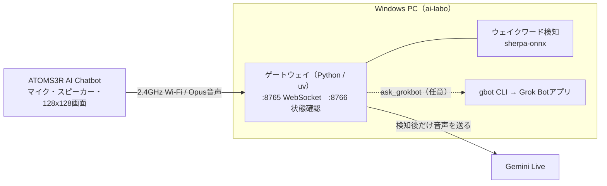

# Windows + ATOMS3R AI Chatbot 構成 設計書

- 対象: `Patagoniano/groki-bot`（`JosssphZhou/groki-bot` のフォーク）、ブランチ `windows-support`
- 基準: upstream `699a370`（2026-10-31）、本体ファームは公式リリース v0.2.2 の `atoms3r`
- 状態: 2026-11-11 にフェーズ0〜4を実機で完了（ウェイクワード→Gemini Live→日本語応答、タスクスケジューラ常駐）。フェーズ5以降は未着手

## 1. 目的と範囲

ATOMS3R AI Chatbotキット（AtomS3R + Atomic Voice Base）を、Windows PC上のゲートウェイ経由で
「Hi Grok」と呼びかけて話せる音声アシスタントにする。

| 区分 | 内容 |
|---|---|
| やる | Windowsネイティブでのゲートウェイ起動、ウェイクワード、Gemini Live音声、常駐化、`gbot` 経由のGrok Bot依頼 |
| やらない | Grokログイン音声（macOS Keychainと非公開APIに依存）、顔追従（Apple Vision）、Macコントロール、USBシリアル制御 |
| 変更しない | 本体ファームウェア（公式v0.2.2をそのまま書き込む） |
| 後続候補 | GPT-Live-1の音声バックエンド追加、ヒヨコ型の外装とサーボ |

## 2. 全体構成



- 本体は音声の入出力と顔表示だけを担当する。APIキーは本体に入れず、PCの `.env` に置く
- ウェイクワードを検知するまで、マイク音声はPCの外に出ない
- PCが止まるかスリープすると会話できない

## 3. 構成要素

| 要素 | 採用 | 補足 |
|---|---|---|
| 本体 | ATOMS3R AI Chatbot（K147） | サーボなし。ボタンAで画面切替とAPモード。USB給電 |
| ファーム | `firmware-v0.2.2-atoms3r.zip` | Web書き込みページから書き込む。upstreamは実機確認を未実施と明記 |
| 接続方式 | XiaoZhi互換WebSocket | 本体の設定ページで接続先を `ws://<PCのLAN IP>:8765` にする |
| PC側実行環境 | Windowsネイティブ + uv | WSL2はロボットからの着信に追加設定が要るため不採用 |
| 音声AI | Gemini Live（`gemini-3.8-live` が既定） | 課金を有効にしたAPIキーを使う |
| ウェイクワード | 「Hi Grok」 | モデルは中国語・英語向け。日本語の呼びかけは動作後に検証 |
| Grok連携 | `gbot` CLI + Grok Botアプリ | フェーズ5。音声はGeminiのまま、作業だけGrok Botへ渡す |

## 4. Windows対応で変更する箇所

| # | 箇所 | 現状 | 対応 |
|---|---|---|---|
| W1 | `stackchan_mcp/opus_codec.py`、`cli.py` | libopusの探索補助がmacOS専用。`STACKCHAN_LIBOPUS_PATH` もmacOSでしか読まれない | Windowsでも `STACKCHAN_LIBOPUS_PATH` を読み、`gateway/vendor/opus.dll` などの既定位置も探す。DLLの入手方法は実機で決める（DLL同梱のwheelを使う案と、手順書で入手先を示す案を比較） |
| W2 | 常駐起動 | `run_stackchan_gateway_launchd.sh` は `mkfifo` と `pkill` に依存 | `scripts/windows/run_gateway.ps1` を新設。stdinを閉じない形で起動し、ログをファイルへ出す |
| W3 | 自動起動 | launchd / systemd の案内のみ | `scripts/windows/install_task.ps1` でタスクスケジューラへ登録（ログオン時） |
| W4 | ウェイクワードモデル取得 | `curl` と `tar` の手順のみ | `scripts/windows/get_kws_model.ps1`（Windows標準の `tar.exe` を利用。bz2展開は未確認） |
| W5 | `gbot` 呼び出し | `shutil.which("gbot")` の結果を直接実行 | Windowsでは `gbot.cmd` に解決される見込み。失敗する場合だけ修正（未確認） |
| W6 | 顔追従の自動起動 | 既定で有効。Mac用の実行ファイルを探す | `.env` で `STACKCHAN_FACE_TRACKER_AUTOSTART=0`、`STACKCHAN_HEAD_FOLLOW_DEFAULT=0`。Windowsでは既定で無効にする修正も検討 |
| W7 | Windows Firewall | 記載なし | TCP 8765の受信をプライベートネットワークに限って許可する手順とスクリプト |
| W8 | CI | `ubuntu-latest` のみ | `windows-latest` でゲートウェイのpytestを追加 |
| W9 | 手順書 | macOS / Linux向け | `gateway/docs/windows.ja.md` と英語版を追加 |

シグナル処理（`add_signal_handler`）は `NotImplementedError` を捕捉済みに見えるが、Ctrl+Cでの停止は実機で確認する。

## 5. 設定値（`gateway/.env`、Git管理外）

```dotenv
GEMINI_API_KEY=            # 実値はここにだけ置く
STACKCHAN_TOKEN=           # ランダムな32文字。本体の設定にも同じ値
HOST=0.0.0.0
WS_PORT=8765
CAPTURE_PORT=8766
STACKCHAN_FACE_TRACKER_AUTOSTART=0
STACKCHAN_HEAD_FOLLOW_DEFAULT=0
STACKCHAN_USB_DISABLE=1
# 実機で必要だった値
STACKCHAN_MANUAL_VAD=0          # このファームは listen stop を送らないため、話し終わり判定をGeminiに任せる
STACKCHAN_MIC_GAIN_DB=24        # Atomic Voice Base のマイクは話し声で約 -55 dBFS と小さい
STACKCHAN_WAKE_PHRASE=hey groki
STACKCHAN_GEMINI_VOICE=Leda
```

日本語で応答させるには `gateway/personality.md`（Git管理外）に「返事は必ず日本語」などを書く。

## 6. 安全とプライバシー

- `STACKCHAN_TOKEN` は必須にする。未設定だとLAN内の任意の機器がロボットとして接続できる
- ウェイクワードのモデルがないと、接続中のマイク音声がすべてGeminiへ送られる。モデルなしでは運用しない
- Gemini APIは課金を有効にしたプロジェクトで使い、予算アラートを設定する（無料枠は入力が製品改善に使われる場合がある）
- 8766番は状態確認用。ファイアウォールでは開けず、PC内からだけ使う
- APIキー、トークン、`.env`、ログの中身はコミットしない
- 目のデータ（`third_party/emotion-ball/`）は非商用ライセンス。商用利用しない

## 7. 進め方と完了条件

| フェーズ | 内容 | 完了条件 | 作業場所 |
|---|---|---|---|
| 0 準備 | フォーク作成、Windowsに Git・uv を用意、Gemini APIキー発行 | `windows-support` をプッシュできる | GitHub / PC |
| 1 本体 | v0.2.2 `atoms3r` を書き込み、Wi-Fi設定 | 顔が表示され、設定ページから見える | ブラウザ + USB-C |
| 2 起動 | `uv sync --all-extras`、変更前のpytest結果を記録、W1を修正 | `stackchan-mcp --check` が通る | PC |
| 3 会話 | W4・W6・W7、本体の接続先を設定 | `/debug/status` が接続済み、「Hi Grok」で返答が聞こえる | PC + 本体 |
| 4 常駐 | W2・W3、スリープ設定の確認 | 再起動後に何もせず会話できる | PC |
| 5 Grok連携 | `gbot` の確認、`ask_grokbot` を有効化、W5 | 声で頼んだ作業がGrok Botに届き、結果を読み上げる | PC |
| 6 仕上げ | W8・W9、upstreamへのPRを相談 | 手順書だけで別のPCに再現できる | GitHub |

フェーズ1と2は互いに独立なので並行して進められる。

### 検証の回し方

このセッションからはWindowsのコマンドを直接実行できない（つながるのはPC内のLinux環境）。
そのため各フェーズで診断用のPowerShellスクリプトを用意し、結果を `logs/` に書き出す。
利用者がスクリプトを1つ実行し、Claudeがログを読んで次の修正を行う。

## 8. リスク

| リスク | 影響 | 対処 |
|---|---|---|
| `atoms3r` ファームが実機で動かない | フェーズ1で停止 | upstreamのIssueを確認。代替はM5Burner経由のXiaoZhi公式ファームを自前ゲートウェイへ向ける案（接続可否は未確認） |
| Atomic Voice BaseとECHO BASEの差 | 音が出ない、拾えない | 販売ページでは改名とされる。フェーズ1で音声を最初に確認 |
| Windowsで依存パッケージが入らない | フェーズ2で停止 | `sherpa-onnx`、`opuslib`、`sounddevice` を個別に切り分け。最終手段はWSL2 |
| 「Hi Grok」を日本語話者の発音で拾いにくい | 使い勝手が悪い | `STACKCHAN_KWS_THRESHOLD` と `STACKCHAN_KWS_SCORE` を調整、別の呼びかけを試す |
| 再生中はマイクが止まる仕様 | 話の途中で割り込めない | 仕様として受け入れる |
| PCのIPアドレスが変わる | 接続が切れる | ルーターでIPを固定する |

## 9. 実機で分かったこと（2026-11-11）

| 事象 | 原因 | 対処 |
|---|---|---|
| ロボット接続直後にゲートウェイが固まる | stdio MCPのスレッドがstdinパイプを読み続け、numpyのDLL読み込みと衝突（py-spyで確認） | `--no-stdio` を追加し常駐時に使用。Windowsではネイティブモジュールを先読み |
| マイク音声が完全な無音 | 本体とベースの接触不良の可能性が高い（差し直し後に音が入った） | 差し直し。GPIO38のLED駆動はES8311のI2C SDAと競合するため既定で無効化（Kconfig） |
| 返事まで30〜45秒 | 手動VADが listen stop を待つが、ファームは送らない | `STACKCHAN_MANUAL_VAD=0` |
| ウェイクワードが反応しにくい | マイク入力が小さい | `STACKCHAN_MIC_GAIN_DB=24` |
| CIでatoms3rがビルド失敗 | m5gfx 0.3.0 が esp_psram.h を依存宣言なしで参照 | `m5stack/m5gfx` を 0.2.x に固定 |
| PowerShellのファイアウォール系コマンドが応答しない | 未特定 | `netsh` を使用 |

残課題: Mac専用の `web_search` 等のツールをWindowsでは無効化する、`gbot` 連携（フェーズ5）、CI（W8）と手順書（W9）。
